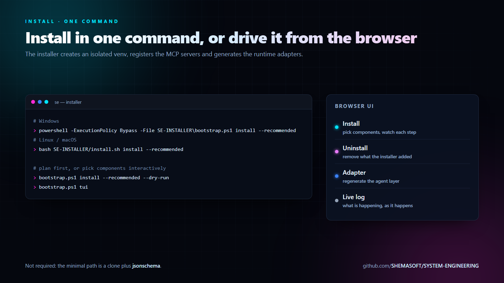
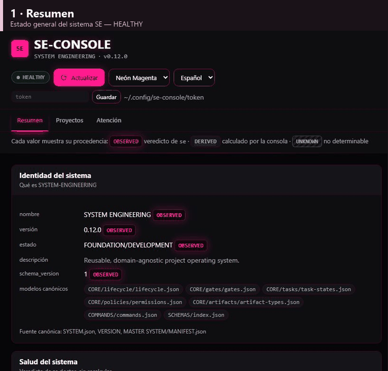

<div align="center">

# SYSTEM ENGINEERING

**A governed runtime for AI coding agents.**
Lifecycle, gates, roles and memory — evidence instead of claims.

[](https://github.com/SHEMASOFT/SYSTEM-ENGINEERING/actions/workflows/ci.yml)
[](https://github.com/SHEMASOFT/SYSTEM-ENGINEERING/tags)
[](LICENSE)
[](https://www.python.org)

[](DOCS/assets/hero.mp4)

<sub>Intake → orchestrator → route → model → gates → checkpoint. <a href="DOCS/assets/hero.mp4">Same clip as MP4</a></sub>

**[Explore the interactive workflow map →](https://shemasoft.github.io/SYSTEM-ENGINEERING/)** · [Why it exists](#why-se) · [5-minute quickstart](#quickstart)

</div>

A reusable, domain-agnostic **project operating system for AI-assisted work**.

SYSTEM ENGINEERING (SE) gives an AI coding runtime structure instead of improvisation:
a lifecycle, gates, roles, commands and skills that turn ad-hoc prompting into a
traceable, repeatable process — for software, data, cloud, security, media, design
or any other kind of project.

This repository **is the system itself**. It creates and operates other projects
without being coupled to them.

| Governed lifecycle | Specialist roles | Evidence, not claims |
|---|---|---|
| `DRAFT → DISCOVERY → … → ARCHIVED`, every transition gated (G0–G8) and recorded | 12 agent roles and 27 commands, loaded on demand instead of one giant prompt | Artifacts, checkpoints (`CP-NNNN`) and a read-only `se trace` over the record graph |

> Version 0.12.0 — Status: **foundation / development**. Smallest system capable of
> becoming the larger one; not yet validated in production.

---

## Quickstart

Clone it and run the reference CLI. That is the whole minimal path: no installer,
no Node, no runtime, no MCP server. It takes a couple of minutes.

```bash
git clone https://github.com/SHEMASOFT/SYSTEM-ENGINEERING.git
cd SYSTEM-ENGINEERING
pip install jsonschema
python SCRIPTS/se.py doctor      # health check
python SCRIPTS/se.py validate    # schemas, agents, domains
```

A healthy checkout ends with (the counts depend on your machine — `FAIL=0` is the
part that matters):

```text
Doctor summary: PASS=21 WARN=0 FAIL=0
VALIDATE: PASS (schemas, agents, domains)
```

- `se doctor` checks the layout, the contracts, the generated adapter, dependencies,
  git and secrets; `se validate` checks the schemas, the 12 agents and the domain
  definitions. Both exit non-zero on `FAIL`, so they are safe to wire into CI.
- `WARN` entries are informational, not failures: `git_available` means no `git` on
  `PATH` for that shell, and `self_containment` on this repository points at guidance
  text in the reference docs, never at an operational surface.
- On Windows use `python SCRIPTS\se.py ...`; on systems without a `python` alias use
  `python3` / `pip3`.

---

## What it is, and what it is not

**What it does.** SE gives an AI coding runtime a process it can execute: a
lifecycle with gates, roles that do one job each, commands and skills loaded on
demand, and a memory that survives sessions. Work produces artifacts, evidence and
receipts instead of claims.

**What it does not do.**

- It is **not a model, an API or a hosted service**. SE ships no credentials and
  calls no provider by itself; it generates the agent layer for a runtime you
  already use.
- It does **not install third-party tools for you** — with one explicit exception:
  the one-command bootstrap (`SE-INSTALLER/bootstrap.ps1`, `SE-INSTALLER/install.sh`
  or `se install --bootstrap`) delegates to the unified installer, which is what
  installs a missing Python, Node.js or OpenCode. A plain `se install` registers
  only servers whose dependencies are already present and reports the rest as skipped.
- It does **not touch anything you did not ask it to touch**. Commands write inside
  the repository or the project directory you name; the console's views are
  read-only, and its only writes come from three explicit, token-authenticated
  actions that you trigger yourself.
- It is **not production-validated yet**. Version 0.12.0 is *foundation /
  development*: usable and tested, but young.

---

## Why SE

| Problem | What SE does |
|---|---|
| Long sessions burn tokens re-explaining context | A **coordinator** orchestrates and delegates to specialized **subagents**; each runs in its own fresh context and returns only its result |
| The model forgets decisions between sessions | **Built-in memory** persists decisions, fixes and discoveries across sessions |
| Everything runs in one giant prompt | Roles, **commands** and **skills** are loaded on demand, not all at once |
| "It works on my machine" process | A **lifecycle with gates** makes every transition explicit, gated and recorded |
| Output nobody can audit | Evidence-based workflow: plans, artifacts and reports instead of claims |

Design principles: **simple · modular · traceable · verifiable · extensible ·
domain-agnostic · human-controlled · tool-independent**.

<div align="center">

[](DOCS/assets/delegation.mp4)

<sub>The coordinator delegates to specialist subagents; each works in its own context and returns only its result.</sub>

</div>

---

## How the pieces fit together

| Piece | What it is | Where it lives |
|---|---|---|
| **SYSTEM ENGINEERING** | The system itself: contracts, lifecycle, gates, CLI, adapters. This repository. | the clone |
| **Managed projects** | The work SE governs: each project keeps its own repository, history and artifacts. SE is never coupled to them. | `PROJECTS/` by default (excluded from version control), or any directory passed with `--dir` |
| **SE Console** | A local web console that shows what SE is, what state it is in and what needs attention. Read-only views, per-project automatic memory, and three token-authenticated actions that delegate to `se`. | `SE-CONSOLE/`, on `http://127.0.0.1:8777` |
| **Runtime adapters** | The generated agent layer (agents, commands, skills) for a runtime such as OpenCode, Claude Code, Codex, DeepSeek Harness, Pi or Hermes. Generated, never hand-edited. | `.opencode/`, `.claude/`, `.codex/`, `.dsh/` |

MCP servers (Context7, filesystem, SE's own skill and memory servers) are
**optional integrations**. None of them is required by SE.

---

## Requirements

| Dependency | Needed for |
|---|---|
| Python 3.10+ | The reference CLI (`SCRIPTS/se.py`) |
| `jsonschema` (`pip install jsonschema`) | Schema validation; `se doctor` fails without it |
| git | Version control checks and project isolation |
| [OpenCode](https://opencode.ai) *(optional)* | Running the generated agent layer |
| Node.js *(optional)* | MCP servers that use `npx` |

Windows, Linux, WSL and macOS are supported. CI runs the full suite on
`ubuntu-latest` and `windows-latest`; the platform-by-platform install notes
(WSL path translation, Homebrew on macOS) live in
[`DOCS/reference/installation.md`](DOCS/reference/installation.md).

---

## Install (optional)

The minimal path above is enough to use SE. The installer adds convenience: an
isolated venv, the console, the selected MCP servers and the runtime adapters.

```powershell
# Windows (PowerShell)
powershell -ExecutionPolicy Bypass -File SE-INSTALLER\bootstrap.ps1 install --recommended
```

```bash
# Linux / macOS
bash SE-INSTALLER/install.sh install --recommended
```

- `--dry-run` plans without installing; `tui` opens the interactive selector
  (`Space` select, `A` recommended set, `Enter` install, `D` dry-run, `R` refresh, `Q` quit).
- If the bootstrap installed Node or OpenCode, open a new terminal so the updated
  `PATH` is loaded, then run `opencode auth login` once.
- **Where the venv goes.** The installer keeps its own venv at `SE-INSTALLER/.venv`,
  which `se doctor` audits cleanly. A differently-named venv *inside* the repository
  makes `se doctor` report `FAIL` on `secrets` and a `WARN` on `root_hygiene`.
- A browser UI over the same installer is documented in
  [`installation.md` §9](DOCS/reference/installation.md#9-instalador-web-interactivo-nuevo).

Full path, components and uninstall: [`DOCS/reference/installation.md`](DOCS/reference/installation.md).

<div align="center">



<sub>Same installer, two fronts: the one-command bootstrap or the browser UI.</sub>

</div>

---

## Configure a runtime (optional)

SE works from the CLI alone. To drive it from an agent runtime, generate the
adapter and point the runtime at it:

```bash
python SCRIPTS/se.py adapter opencode      # .opencode/   (audited by se doctor)
python SCRIPTS/se.py adapter claude-code   # .claude/ + .mcp.json + CLAUDE.md
python SCRIPTS/se.py adapter codex         # .codex/ + AGENTS.md
python SCRIPTS/se.py adapter deepseek      # .dsh/ + AGENTS.local.md (patch overlay)
python SCRIPTS/se.py adapter pi            # settings.json + .pi/ + skills
python SCRIPTS/se.py adapter hermes        # settings.json + AGENTS.md + .hermes/ + skills
python SCRIPTS/se.py adapter all           # claude-code, codex, deepseek and pi at one output root
```

`se adapter opencode` writes **12 agents, 27 commands and 7 skills**, all generated
— never edit them by hand, regenerate instead. Every adapter is deterministic,
idempotent and portable (no absolute host paths).

To make new sessions start as the coordinator, set its agent id in `opencode.jsonc`
(the master repository already does this):

```jsonc
{
  "default_agent": "shema-ai-coordinador",
}
```

Runtime specifics live in [`INTEGRATIONS/`](INTEGRATIONS/) and
[`DOCS/reference/adapters.md`](DOCS/reference/adapters.md).

---

## Your first project

A **project** is the thing SE governs. Four commands work on a fresh clone:

```bash
# 1. Create a managed project (its artifacts live under PROJECTS/)
python SCRIPTS/se.py init --dir PROJECTS/MyApp --name "MyApp" --owner "me" --domains software

# 2. Evaluate the intake gate
python SCRIPTS/se.py gate --project PROJECTS/MyApp --gate G0

# 3. Move the project through that gate
python SCRIPTS/se.py transition --project PROJECTS/MyApp --to DISCOVERY --by "me"

# 4. See where it stands
python SCRIPTS/se.py status --project PROJECTS/MyApp
```

**`se status` reports `Overall: FAIL` on a brand-new project, and that is correct**:
most later gates (G1, G2, G3, G5, …) have nothing to check yet because there are no
requirements, tasks or evidence. The command exits `1` while any gate fails; that
exit code is the verdict, not a crash.

Every transition is gated and fail-closed: a blocked transition reports which gate
condition failed, manual conditions need a written human attestation
(`--attest "<reason>"`), and `se release` never records an empty approver.

### Lifecycle states

`se transition` accepts only the states in
[`CORE/lifecycle/lifecycle.json`](CORE/lifecycle/lifecycle.json):

| State | Meaning | Gate in |
|---|---|---|
| `DRAFT` | Project registered but not yet explored | — (start) |
| `DISCOVERY` | Context, constraints and unknowns are being identified | G0 |
| `PLANNING` | Requirements and plan are being defined | G1 |
| `ACTIVE` | Implementation work is in progress | G2, G3 |
| `VERIFICATION` | Implementation is being verified against requirements | G4 |
| `ACCEPTANCE` | Owner reviews and formally accepts the result | G5 |
| `RELEASED` | A release has been produced | G6, G7 |
| `OPERATING` | The released system is in operation | G8 |
| `ARCHIVED` | Project is closed and preserved | — (terminal) |

`BLOCKED` is a condition, not a state: it is recorded with a reason and a
resolution path. Some gate conditions are `[MANUAL]` — they require a human
attestation with a written reason, and SE never auto-approves them.

<div align="center">

[](DOCS/assets/lifecycle.mp4)

<sub>Every transition is gated (G0–G8): FAIL and WARN block, MANUAL needs a written attestation.</sub>

</div>

---

## Console, memory and work modes

**SE Console** — a local web console over the system, with three views:
**Overview** (what SE is, its health and its capabilities), **Projects** (every
managed project with its 9-step lifecycle and gate matrix) and **Attention**
(everything that needs action: failing gates, manual conditions, review gaps —
grouped by project and ordered by priority, never a governance verdict).

It is read-only by design: GET routes only, plus a single token-authenticated
`POST /api/action` limited to three catalog actions (`run checkpoint`,
`run close`, `transition --attest`). The token lives at
`~/.config/se-console/token`, outside the repository. Every value on screen
carries its provenance — `OBSERVED` (relayed from `se`), `DERIVED` (computed by
the console) or `UNKNOWN` — so a state is never invented.

Opening a project card shows its detail with an **automatic memory panel**
(current focus, next steps, notes and context) generated from project state, so
you never have to remember where you left off. Clicking any attention row opens
a drawer with the steps to follow, what the item belongs to and the actions
available.

<div align="center">

[](SE-CONSOLE/docs/README.md)

<sub>Overview → Projects → project detail with automatic memory → Attention → the steps to follow.</sub>

</div>

```bash
cd SE-CONSOLE
python scripts/dev_console.py start    # http://127.0.0.1:8777, in the background
python scripts/dev_console.py status
python scripts/dev_console.py stop
```

`start` arms a 15-minute idle timeout; `--idle-timeout 0` keeps it up. One-click
double-click helpers ship for Windows (`Start SE Console.cmd`) and macOS
(`Start SE Console.command`), and no administrator privileges are needed.

Three themes (`magenta` by default, `azul`, `claro`) with 16 tokens each and
verified AA contrast; English or Spanish UI, switchable in the header; no
animations. The full guide, in simple Spanish and fully visual, lives in
[`SE-CONSOLE/docs/README.md`](SE-CONSOLE/docs/README.md).

**Persistent memory** — built in, no external server: one JSON record per memory
inside the project (`memories/MEM-XXXX.json`), a rebuildable index under `.se/`,
and an optional local reranker. Memory is **advisory**: no gate passes or fails
because of it, and the auditable record stays in the project artifacts. Storage
model and session-start convention: [`DOCS/reference/memory.md`](DOCS/reference/memory.md).

## Neon Magenta

Identidad visual de SE-CONSOLE: tres temas integrados (`magenta` por defecto, `azul`, `claro`), paletas de 16 tokens cada uno, glows de neón sin animaciones y contraste de color verificado (nivel AA) en todos los temas.

[](SE-CONSOLE/docs/README.md)

### Temas

| Tema | Uso | Contraste mínimo |
|------|-----|------------------|
| `magenta` (por defecto) | Interfaz principal, paneles y glows de neón | 5.32:1 |
| `azul` | Variante de acento para sesiones largas | 6.50:1 |
| `claro` | Modo diurno / alta luminosidad | 4.57:1 |

Colores de marca: magenta `#F095C8` sobre fondo oscuro `#1A1218`. Los detalles de aplicación y los tokens de cada paleta viven en [`SE-CONSOLE/docs/README.md`](SE-CONSOLE/docs/README.md).

---

<div align="center">

[](DOCS/assets/token-economy.mp4)

<sub>A large output is persisted and referenced by id, so the next node receives a pointer instead of the payload.</sub>

</div>

**Work modes** — the agent picks the mode from the project, not from habit:
`organic` (daily flow), `spec` (contract changes and large/high-risk work, needs an
approved SDD) and `receipt` (a verdict bound to the exact change candidate, needs a
passing RDD). The rule is executable, not advice: it lives in
[`CORE/policies/ceremony.json`](CORE/policies/ceremony.json), `se ceremony --project`
shows the floor and `se validate --project` enforces it. See
[`DOCS/reference/work-modes.md`](DOCS/reference/work-modes.md).

<div align="center">

[](DOCS/assets/modes.mp4)

<sub>Explore with an ODD, agree with an SDD, prove with an RDD — the project's scale and risk decide which one is required.</sub>

</div>

---

## Projects

```bash
# Create one
python SCRIPTS/se.py init --dir PROJECTS/MyApp --name "MyApp" --owner "me" --domains software

# Bring an existing project under the lifecycle (additive: never overwrites)
python SCRIPTS/se.py adopt PROJECTS/LegacyApp --owner "me" --scale large --risk high --criticality high
```

`se init` also takes `--agents`, `--skills` and `--criticality`
(`low|medium|high|critical|unknown`, defaulting to `unknown` — never a silent
guess). A project can declare an optional `profiles.work` block in `PROJECT.json`,
which `se validate --project` enforces. `se adopt` writes `PROJECT.json` and the
empty workspace directories and leaves every existing file byte-for-byte untouched;
`--dry-run` plans without writing.

References: [`project-bootstrap.md`](DOCS/reference/project-bootstrap.md),
[`project-profile.md`](DOCS/reference/project-profile.md).

---

## Repository map

| Path | Purpose |
|---|---|
| `CORE/` | Lifecycle, gates, task states, artifact and permission models |
| `DOMAINS/` | Domain-pack contract and initial domain definitions |
| `AGENTS/` | Agent contract and the 12 agent definitions |
| `COMMANDS/` | Command contracts (rendered into runtime commands) |
| `SKILLS/` | LLM-first skills (Agent Skills format) |
| `SCHEMAS/` | Machine-readable JSON Schemas for core artifacts |
| `TEMPLATES/` | Fill-in templates for artifacts, projects and MCP servers |
| `SCRIPTS/` | Reference Python CLI (`se.py`, `se_core/`) |
| `POLICIES/` | Human-readable policies (permissions, evidence, release, security) |
| `INTEGRATIONS/` | Runtime adapters (OpenCode, Claude Code, Codex, DeepSeek Harness) and the provider-neutral CI governance adapter |
| `SE-CONSOLE/` | Local-first web console: read-only views, authenticated actions |
| `SE-INSTALLER/` | Unified installer + TUI for SE + MCP servers + runtimes |
| `DOCS/` | Architecture, references, the workflow visualization and the video sources |
| `TESTS/` | Hermetic tests for the Master System itself |

---

## Troubleshooting

| Symptom | Cause | Fix |
|---|---|---|
| `FAIL` on `jsonschema` | The optional validation dependency is missing | `pip install jsonschema` (or use the installer venv) |
| `FAIL` on `secrets` + `WARN` on `root_hygiene` | A virtualenv was created inside the repo with a name other than `.venv` | Keep the venv outside the repo, or name it `.venv` at the root |
| `[WARN] git_available` | `git` is not on `PATH` for this shell | Install git or open a new terminal; it is a `WARN` |
| `[WARN] self_containment ... none on operational surfaces` | Guidance text mentions host paths | Informational. A hit **on an operational surface** is what must be fixed |
| `Overall: FAIL` right after `se init` | Later gates have nothing to check yet | Expected: pass the gates in order as the project produces artifacts |
| `target state '...' is not a valid state` | The lifecycle names are fixed | Use one of the nine states, e.g. `--to DISCOVERY` |
| A gate shows `[MANUAL]` and the transition stops | Human attestation is required by design | `se transition ... --attest "<reason>"` |
| `opencode` or `node` not found after the bootstrap | The installer updated `PATH` for its own process only | Open a new terminal |
| `se doctor` fails after editing `.opencode/` | `.opencode/` is generated; edits show as manifest drift | Edit `AGENTS/`, `COMMANDS/`, `SKILLS/` or `TEMPLATES/` and regenerate |

Still stuck? See [`SUPPORT.md`](.github/SUPPORT.md).

---

## Documentation

Start at [`DOCS/reference/architecture.md`](DOCS/reference/architecture.md); the full
index is [`DOCS/README.md`](DOCS/README.md).

- [`installation.md`](DOCS/reference/installation.md) — obtain, install, run, update
- [`core-model.md`](DOCS/reference/core-model.md) — lifecycle, gates, tasks, artifacts
- [`work-modes.md`](DOCS/reference/work-modes.md) — organic / spec / receipt, SDD/ODD/RDD
- [`commands.md`](DOCS/reference/commands.md) — the command surface
- [`workflows.md`](DOCS/reference/workflows.md) — multi-agent DAG execution
- [`lifecycle.md`](DOCS/reference/lifecycle.md) — install/sync/update/uninstall lifecycle
- [`opencode-adapter.md`](DOCS/reference/opencode-adapter.md) — how the agent layer is generated

The interactive map of the workflow is at
<https://shemasoft.github.io/SYSTEM-ENGINEERING/>; its sources, and the sources of
the hero and the social clips, are in [`DOCS/visuals/`](DOCS/visuals/).

---

## Contributing

See [`CONTRIBUTING.md`](CONTRIBUTING.md). CI runs `se doctor`, `se validate` and the
full test suite on Linux and Windows for every pull request.

- **Bugs, questions, feature requests** — [open an issue](https://github.com/SHEMASOFT/SYSTEM-ENGINEERING/issues)
- **Help and where to ask** — [`SUPPORT.md`](.github/SUPPORT.md)
- **Security** — [`SECURITY.md`](.github/SECURITY.md); do not disclose a vulnerability in a public issue
- **Community standards** — [`CODE_OF_CONDUCT.md`](.github/CODE_OF_CONDUCT.md)

## License

MIT — see [`LICENSE`](LICENSE). Keep the copyright and permission notice in any copy
or substantial portion you distribute. Some skills adapt third-party material that
carries its own license; the attribution lives with the skill itself (for example
[`SKILLS/visual-frontend-engineering/SKILL.md`](SKILLS/visual-frontend-engineering/SKILL.md)),
and the MIT license of this repository does not override those terms.

## Author

Developed and maintained by [Moises](https://github.com/SHEMASOFT), owner of the
[`SHEMASOFT`](https://github.com/SHEMASOFT) GitHub account. Contributions from other
developers are recorded in the [commit history](https://github.com/SHEMASOFT/SYSTEM-ENGINEERING/commits/main)
and are not attributed to the maintainer.
