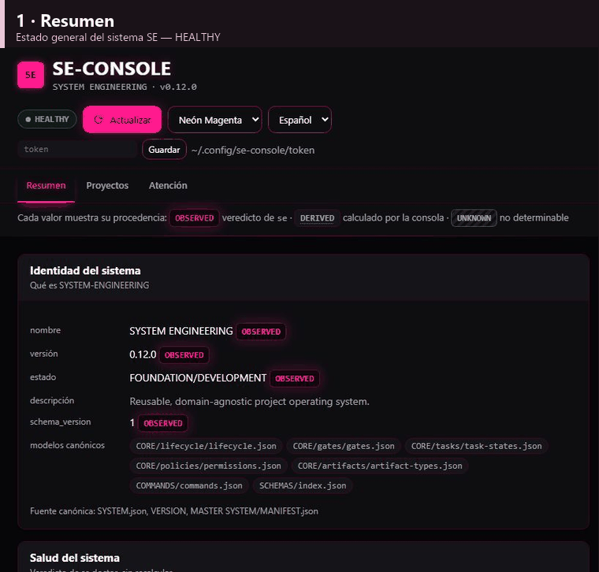
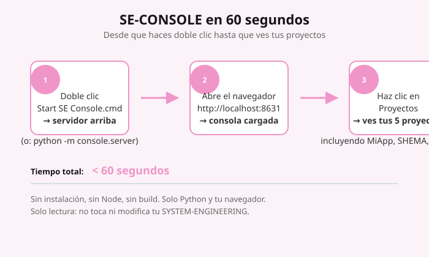
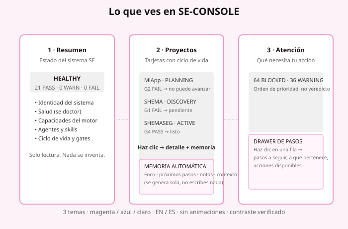

# SE-CONSOLE

Consola local, solo lectura, para ver el estado de tus proyectos en SYSTEM-ENGINEERING.

<div align="center">
  

  **SE-CONSOLE** te muestra en un solo lugar: qué proyectos tienes, en qué estado están, qué necesitas atención y una memoria automática de cada proyecto.

  [](https://github.com/SHEMASOFT/SYSTEM-ENGINEERING)
  [](https://github.com/SHEMASOFT/SYSTEM-ENGINEERING)
  [](https://github.com/SHEMASOFT/SYSTEM-ENGINEERING)
</div>

---

## Demo en acción



<sub>Recorrido real: Resumen → Proyectos → detalle con memoria automática → Atención → pasos a seguir.</sub>

---

## Qué hace (y qué no)

**Qué hace:**
- Muestra tus proyectos (MiApp, SHEMA, SHEMASEG, workflow-demo y `_template`)
- Te dice en qué fase está cada uno (flujo de 9 pasos) y qué sigue
- Agrupa todo lo que necesita atención (gates que fallan, condiciones pendientes, gaps de revisión)
- Genera una **memoria automática** por proyecto: en qué estás trabajando, próximos pasos y notas — sin que escribas nada

**Qué no hace:**
- No escribe ni modifica nada en SYSTEM-ENGINEERING (solo lee)
- No necesita instalación, ni Node, ni build, ni base de datos
- No necesita privilegios de administrador

---

## Empezar en 60 segundos



### O por línea de comandos

Desde la carpeta `SE-CONSOLE/`:

```powershell
# Iniciar
python scripts\dev_console.py start

# Abrir en el navegador
# http://localhost:8777

# Ver estado
python scripts\dev_console.py status

# Detener
python scripts\dev_console.py stop
```

O directamente, sin el helper:

```powershell
python -m console.server
# -> http://localhost:8777
# Si ya hay una consola corriendo, el segundo intento se rechaza con un mensaje
# accionable. Para abrir otra, elige otro puerto:
python -m console.server --port 8778
```

---

## Qué ves en la consola



### 1 · Resumen
Estado general del sistema SE: salud, versión, capacidades, agentes y gates.

### 2 · Proyectos
Tarjetas con el flujo de 9 fases de cada proyecto. Haz clic en una para ver su detalle: memoria automática (foco, próximos pasos, notas, contexto) y matriz de gates.

### 3 · Atención
Todo lo que necesita tu acción. Puedes agruparlo por proyecto (default) o por causa raíz con el selector **Agrupar por**. En el desplegable **Silenciar causas** puedes ocultar causas repetidas: la preferencia se guarda solo en este navegador y no cambia ningún dato del sistema. Haz clic en cualquier fila para abrir un cajón con pasos a seguir, a qué pertenece y acciones disponibles.

### 4 · Informes
Ejecuta `health`, `verify`, `gate` y `plan` sobre un proyecto con un argv validado. Son solo lectura: la consola muestra el sobre `se.report/1` tal como lo emite el motor. `plan` nunca crea tareas.

### 5 · Buscar
Coincidencias léxicas sobre nombres de proyecto, memoria de la consola y registros canónicos. Es una ayuda para encontrar información, no un veredicto de governance.

Cuando `se doctor` falla o avisa, cada check tiene un botón **Arreglar**: abre los comandos exactos para copiar en tu terminal. La consola no los ejecuta por ti.

---

## Temas e idioma

| Opción | Valores | Guardado en |
|--------|---------|-------------|
| Tema | magenta (default), azul, claro | `localStorage` → `se-console-theme` |
| Idioma | español, inglés | Selector en la cabecera |

Los temas usan los colores `#1A1218` (fondo oscuro) y `#F095C8` (magenta neón). El contraste se verificó en los 3 temas (nivel AA).

---

## Inicio y apagado (un clic)

Los scripts viven en `SE-CONSOLE/scripts/`:

| Archivo | Qué hace |
|---------|----------|
| `Start SE Console.cmd` | Inicia el servidor y abre el navegador (doble clic) |
| `Stop SE Console.cmd` | Detiene el servidor (doble clic) |
| `dev_console.py` | `start`, `stop`, `status`, `restart`, `logs` desde terminal |

En Windows también puedes crear un acceso directo en el escritorio apuntando a `scripts\Start SE Console.cmd`.

El servidor se detiene solo tras 15 minutos sin nadie usando la consola, o cuando cierras el navegador.

---

## Requisitos

- Python (el mismo que usa `se`)
- `jsonschema` (ya instalado para `se doctor`)
- Nada más. No hay `npm install`, no hay Node, no hay Docker.

Puedes cambiar la carpeta de SE con `SE_ROOT` y el puerto con `SE_CONSOLE_PORT`.

---

## Seguridad: solo lectura

Capa tras capa, la consola no puede escribir:

1. Solo hay rutas GET. No existe POST/PUT/PATCH/DELETE.
2. Cualquier verbo de escritura recibe `405`.
3. El lector de SE rechaza comandos mutantes por nombre (`new`, `update`, `transition`, etc.).

Cada valor en pantalla trae su procedencia: `OBSERVED` (vino de `se`), `DERIVED` (calculado por la consola) o `UNKNOWN` (no se pudo determinar). Nunca se inventa un estado.

---

## Verificar que funciona

```powershell
python tests\validate_poc.py    # 33 comprobaciones
python tests\audit_visual.py    # contraste, solapamiento, tamaño de objetivo
```

Ambos escriben evidencia en `artifacts/evidence/` y fallan si algo no pasa.

---

## Límites conocidos

- `se doctor` tarda unos 9 segundos, por lo que la pestaña Resumen tarda ~10s en llenarse. Es el costo real del motor; la consola no puede almacenarlo en caché.
- El proyecto `_template` aparece como **no gestionado** (no tiene `PROJECT.json`): se muestra tal cual, sin inventar estado.
- No hay revisión visual automática (vision capability no disponible en este entorno).

---

¿Necesitas ayuda? Abre un issue en este repositorio o contacta al mantenedor de SYSTEM-ENGINEERING.
